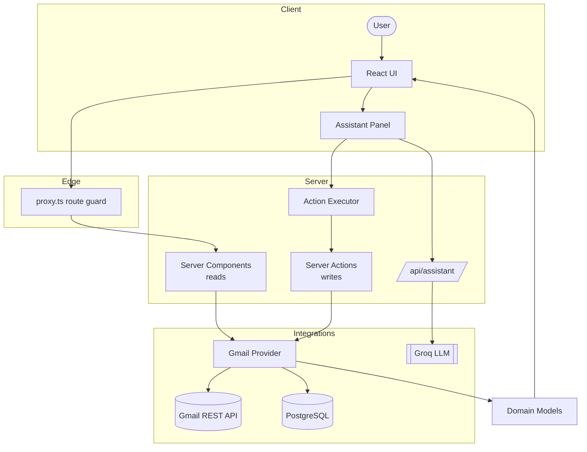
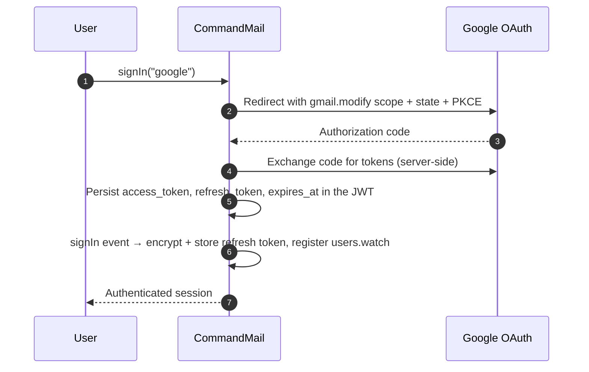
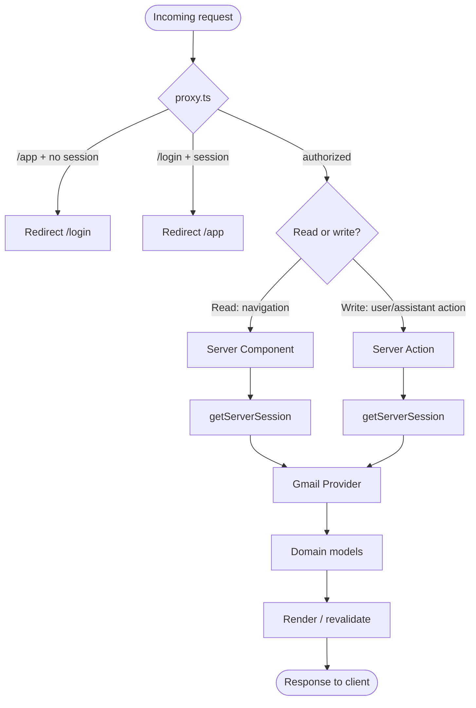
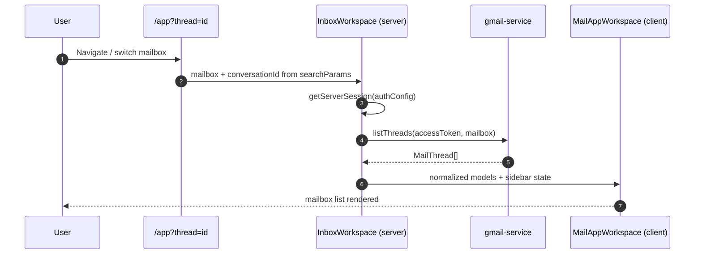
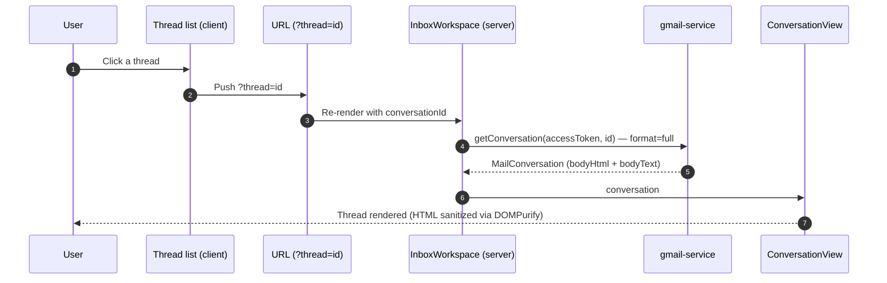
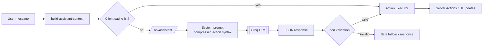
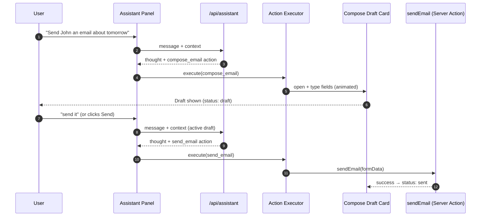
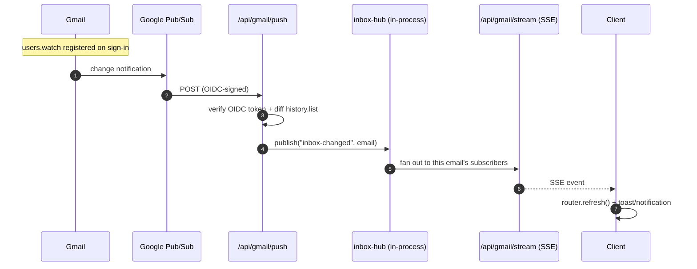

# Architecture

Engineering design for CommandMail. This documents the system as built — where something is deliberately deferred or absent, it says so rather than describing an aspiration as if it shipped.

## Goals

- **The assistant controls the UI through the same code the UI already runs.** No privileged path to Gmail or the DOM. This is the core product requirement and the main safety constraint.
- **Real Gmail, end to end.** OAuth, real sends, real threads, real-time push — no mocks or fixtures standing in for the provider.
- **A UI that never sees Gmail's shapes.** Product code works with a small set of domain models; the provider is swappable in principle without touching a component.
- **Legible state ownership.** Every piece of state has exactly one owner, and it's obvious which one.
- **Small, boring infrastructure.** Prefer the simplest thing that satisfies the brief for a single instance over infrastructure the assignment doesn't need.

## Non-goals

- **Multi-provider abstraction.** There is one mail provider (Gmail) and one LLM provider (Groq). Interfaces for a second of either are deferred until a second actually exists — a premature interface designed against one implementation is usually wrong.
- **Horizontal scale.** The realtime hub is in-process and assumes a single instance. Multi-instance fan-out (Redis) is designed for but not built.
- **A full mail client.** No delete/label-move/settings surface. The feature set is scoped to the assignment plus the bonuses.
- **Client-side data caching for mail.** Reads happen in Server Components; there is deliberately no client mail cache yet.

## Architecture philosophy

Two ideas do most of the work.

**The assistant is a caller, not an actor.** An LLM that can reach the mailbox or the DOM directly is a second privileged actor whose behavior you can't bound. Instead, the model's entire output is a `thought` plus a list of typed actions from a fixed schema. A deterministic executor validates each action and runs it through the *same* Server Actions and handlers a button click uses. The model decides *what* to do; the app owns *how* it happens. The assistant can therefore do everything the UI can and nothing more.

**Gmail is an integration, not the product.** Product code (`features/mail`, components, the assistant) only ever sees `MailThread` / `MailConversation` / `MailDraft` / `ReplyMailDraft`. Gmail's response shapes stay inside `features/gmail` behind mappers. The cost is a mapping layer; the benefit is that the entire UI is provider-agnostic and the blast radius of a Gmail change is one folder.

## System overview



Both the manual UI and the assistant converge on the same Server Actions and the same provider. The assistant never has an edge the UI lacks.

## Layers

- **UI** (`app/`, `features/*/components`) — screens and the assistant panel.
- **Orchestration** — Server Components for reads (`InboxWorkspace` calls `getServerSession` + the provider), Server Actions for writes (`sendEmail`, `sendReplyEmail`, `searchMailThreads`, `markThreadRead`), and Route Handlers for OAuth, the assistant, and the Gmail webhook/stream.
- **Assistant** (`features/assistant/`) — builds context + prompt, calls Groq, validates the response, executes actions through the mail Server Actions.
- **Provider** (`features/gmail/`) — Gmail REST calls, MIME parsing, and mapping Gmail responses into domain models.
- **Shared** (`shared/`, `config/`) — UI primitives, utilities, constants, and config.

## Folder organization

```text
src/
├── app/              # Routes, layouts, API handlers, app shell
│   ├── (main)/app/   # Authenticated shell (header, sidebar) + mail workspace
│   ├── api/          # auth, assistant, gmail (push/stream/renew-watch), health
│   └── login/        # Sign-in route
├── config/           # Env parsing + product/site config
├── features/
│   ├── auth/         # OAuth config, token refresh, Google provider setup
│   ├── gmail/        # Gmail REST integration, mappers, watch/sync, token crypto
│   ├── mail/         # Product UI, domain types, workspace, mail Server Actions, live-sync hook
│   └── assistant/    # Assistant panel, prompt building, action schema, executor
├── server/           # Prisma client, in-process realtime hub
├── shared/           # ui / lib / constants
└── proxy.ts          # Route protection (Next.js middleware equivalent)
```

- `features/mail/` consumes `MailThread` / `MailConversation` / `MailDraft` / `ReplyMailDraft` only.
- `features/gmail/` returns domain models and hides Gmail shapes; nothing outside it imports `GmailThreadResponse` or peers.
- `features/assistant/` talks to Groq and to `features/mail` Server Actions — never to Gmail or the DOM directly.

## Design decisions & trade-offs

| Decision | Why | Trade-off |
| -------- | --- | --------- |
| Assistant returns typed actions run through existing Server Actions | The model can't exceed the UI's capabilities; behavior stays bounded and auditable | The assistant is limited to what the UI can already do (intended) |
| Gmail behind a domain layer | Provider-agnostic UI; change blast radius contained to one folder | An extra mapping layer; no provider interface yet |
| Reads in Server Components, writes in Server Actions | Simple auth boundary, minimal client state | `router.refresh()` round-trip instead of optimistic updates |
| No provider/LLM interface yet | An interface designed against a single implementation is usually wrong | Some direct coupling to Gmail/Groq today |
| In-process realtime hub | Smallest thing that delivers live sync on one instance | Single-instance only; needs Redis to scale out |
| Draft-then-send as the confirmation | The visible draft *is* the human-in-the-loop gate | No separate "are you sure?" affordance |
| URL owns shareable state | Threads and mailboxes are linkable/bookmarkable | Some prop threading through the workspace |

## Authentication

OAuth 2.0 Authorization Code flow via Auth.js (NextAuth v4), with all token handling on the server.



Google access tokens expire in ~1 hour. The JWT callback persists `accessToken` / `refreshToken` / `accessTokenExpires` on sign-in, returns the cached token while it's valid, and calls `refreshGoogleAccessToken()` once it's expired — preserving the existing refresh token unless Google issues a new one. If refresh fails, `session.error = "RefreshAccessTokenError"` surfaces to the UI so it can prompt a reconnect.

- `features/auth/services/google-provider.ts` — `access_type: "offline"`, `prompt: "consent"`, `gmail.modify` scope.
- `features/auth/server/auth-config.ts` — JWT/session callbacks and the `signIn` event.
- `features/auth/server/refresh-google-access-token.ts` — refresh logic.
- `proxy.ts` — route protection: `/app` requires auth, `/login` redirects if already authenticated.

Refresh tokens never reach the browser. Code outside `features/auth` only ever does:

```typescript
const session = await getServerSession(authConfig);
await listThreads(session.accessToken, mailbox);
```

Gmail services don't manage token lifecycle themselves — they take an access token and use it.

## Request lifecycle

Every request first passes the route guard, then splits by read vs. write.



Reads have no dedicated API routes — they run in Server Components. Writes (send, reply, search, mark-read) go through Server Actions. The assistant's LLM call is the one exception that uses a Route Handler (`POST /api/assistant`), because it needs a request/response boundary the client can `fetch`.

## Mail loading lifecycle



A mailbox load is `list` + one metadata fetch per thread, run with `Promise.allSettled` so a single failed thread doesn't break the mailbox. That's fine at this scale; batching the metadata fetch is the first thing to change past ~50 threads.

## Conversation opening

Opening a thread is a URL change (`?thread=`), not client state — so it's shareable, survives reload, and re-renders the Server Component with the conversation loaded.



## AI assistant

The assistant panel (`features/assistant/components/assistant-panel.tsx`) is mounted once by `AssistantProvider` in `app/(main)/app/layout.tsx`, so it persists across mailbox and thread navigation instead of remounting per page.

### Pipeline



`POST /api/assistant` builds a system prompt from the current mailbox/conversation/draft/search-result context, calls Groq, and Zod-validates the JSON before returning it. The assistant is a pure orchestrator — it returns a `thought` plus zero or more typed actions and never executes anything itself. The client runs returned actions through `executeAssistantActions`, which calls the same handlers/Server Actions the manual UI uses. Invalid or unparseable model output degrades to a safe fallback rather than throwing.

Seven actions, nothing else is possible (`assistant-action.ts`):

| Action | Payload | Effect |
|--------|---------|--------|
| `compose_email` | `to, subject, body` | Opens/fills the compose draft card |
| `send_email` | — | Sends whichever draft is currently active |
| `search_emails` | `query` | Runs a Gmail query; results replace the inbox list |
| `open_email` | `threadId` | Opens a specific thread in the detail view |
| `reply_email` | `threadId, body` | Drafts a reply against the given conversation |
| `forward_email` | `threadId, to, body` | Drafts a forward of the given conversation |
| `navigate_mailbox` | `mailbox` | Switches the active mailbox (Inbox/Sent/Drafts/Archive/Trash) |

`threadId` must come from context the model actually saw (a prior search result or the open conversation); the prompt forbids inventing one, and there's no lookup path that would let an invented id resolve to anything.

### AI compose flow

The most visible action — turning _"email John about tomorrow"_ into a filled, sendable draft — is deliberately two steps, with the draft as the confirmation gate.



`compose_email` / `reply_email` / `forward_email` produce a draft rendered by the same `ComposeDraftForm` used for manual compose; `send_email` calls the identical `sendEmail` / `sendReplyEmail` functions a manual Send click would. Drafts show live status (preparing → writing → draft → sending → sent/failed) with a retry on failure.

### Cost control

The system prompt uses a compressed action syntax instead of the full JSON schema; context is serialized as compact key/value pairs instead of raw JSON; chat history is trimmed to the last 8 messages (`MAX_ASSISTANT_HISTORY`); and identical prompt+context pairs are served from a per-tab, 5-minute client cache (`assistant-response-cache.ts`) instead of re-hitting Groq. The LLM is the single interpreter of intent — there's no rules engine racing it.

## Gmail integration

| Concern | Location |
|---------|----------|
| REST calls | `features/gmail/services/gmail-service.ts` |
| Internal API types | `features/gmail/types/gmail-api.ts` |
| Mappers | `features/gmail/mappers/` |
| Public methods | `listThreads()`, `searchThreads()`, `getConversation()`, `markThreadAsRead()`, `sendMail()`, `sendReplyMail()` |
| Return types | `MailThread[]`, `MailConversation`, `MailDraft`, `ReplyMailDraft` |

- `fetch()` against `gmail.googleapis.com` — no Google SDK.
- `listThreads` uses `Promise.allSettled` so one failed thread fetch doesn't break the mailbox.
- `searchThreads` runs the same list path with a raw Gmail `q=` query — this backs the assistant's `search_emails` action and would back a UI search box too.
- `getConversation` fetches `threads.get?format=full`, keeping both `bodyHtml` and `bodyText`; the conversation view renders HTML sanitized with DOMPurify (`email-html-frame.tsx`), falling back to text.
- `sendMail` / `sendReplyMail` build a MIME message (`build-mime-message.ts`) and POST to `messages.send`; the reply variant sets `In-Reply-To` / `References` so Gmail threads it correctly.

**Known gaps:** Gmail is the only provider; there are no delete/archive/label-move actions yet despite Archive/Trash existing as read destinations; a mailbox load is 1 + N Gmail requests.

## Domain models

`features/mail/types/`:

```typescript
interface MailAddress { name: string; email: string; }

// Mailbox list row (Inbox/Sent/Drafts/Archive/Trash)
interface MailThread {
  id: string;
  sender: string;
  senderEmail?: string;
  subject: string;
  snippet: string;
  receivedAt: string;
  isUnread: boolean;
}

// Single message in a conversation
interface MailMessage {
  id: string;
  sender: MailAddress;
  to: MailAddress[];
  cc: MailAddress[];
  subject: string;
  rfcMessageId?: string;
  references?: string;
  bodyHtml?: string;
  bodyText?: string;
  sentAt: string;
}

interface MailConversation { id: string; subject: string; messages: MailMessage[]; }

// Outbound new message
interface MailDraft { to: string[]; subject: string; body: string; }

// Outbound reply — carries the RFC headers Gmail needs to thread it correctly
interface ReplyMailDraft {
  threadId: string;
  inReplyTo: string;
  references: string;
  to: string[];
  subject: string;
  body: string;
}
```

The assistant operates on these same types — there is no separate "AI-shaped" domain model.

## Realtime architecture

New mail appears without a refresh, via Gmail push (not polling).



- **Watch registration** (`features/gmail/server/gmail-watch.ts`) — `users.watch` on `INBOX` against `GMAIL_PUBSUB_TOPIC`, registered in the NextAuth `signIn` event; sign-in still succeeds if it fails.
- **Webhook** (`app/api/gmail/push/route.ts`) — verifies the Pub/Sub OIDC token (`GMAIL_PUSH_AUDIENCE` / `GMAIL_PUSH_SA_EMAIL`) before trusting anything, then walks `history.list` from the stored `historyId`, resetting the baseline when the history gap is too old.
- **Hub** (`server/realtime/inbox-hub.ts`) — an in-process `Map<email, Set<listener>>`. **Single-instance assumption.**
- **Stream** (`app/api/gmail/stream/route.ts`) — one SSE connection per tab, with a 25s heartbeat and proxy buffering disabled (`X-Accel-Buffering: no`).
- **Sync state** (`GmailSync` table, `features/gmail/server/gmail-sync.repository.ts`) — per-user `historyId`, watch expiration, and the AES-256-GCM-encrypted refresh token.
- **Watch renewal** (`app/api/gmail/renew-watch/route.ts`) — a `CRON_SECRET`-protected endpoint that re-registers watches before Gmail's ~7-day expiry.

## State management

| State | Owner |
|-------|-------|
| Selected conversation | URL (`?thread=`) |
| Selected mailbox | URL (route segment) |
| Mailbox / conversation data | Server Components, fetched per render |
| Focus Mode | `useState` in `MailAppWorkspace` |
| Auth session | Auth.js JWT |
| Assistant conversation, active draft, search results | React Context (`AssistantProvider`), above the route so it survives navigation — not persisted across a page reload |

Guiding rule: every piece of state has exactly one owner. TanStack Query and `QueryClientProvider` are wired but mail data isn't cached through Query yet — Server Components are simpler while there's no client mutation/caching need forcing the issue. The assistant's client state is plain `useState`/`useRef`, which has been enough.

### Focus Mode

A layout presentation mode, not a route/modal/overlay — the same `ConversationView`, rendered with `mode="default" | "focus"`. `isFocusMode` is `useState` in `MailAppWorkspace`; `AppShell` hides the header/sidebar when it's on; switching threads (`key={conversationId}`) resets it. `F` toggles, `Esc` exits (both ignored while typing in an input). The assistant panel floats above both layouts (fixed bottom-right), so it doesn't shrink either grid.

## Security

- **Refresh tokens encrypted at rest** — AES-256-GCM via `TOKEN_ENCRYPTION_KEY` (`features/gmail/server/token-crypto.ts`), covered by a round-trip test. They never reach the browser.
- **Webhook authenticity** — `/api/gmail/push` verifies the Pub/Sub OIDC token before acting on any payload; an unsigned or wrong-audience request is rejected.
- **Cron authenticity** — `/api/gmail/renew-watch` requires the `CRON_SECRET` bearer.
- **Route protection** — `proxy.ts` gates `/app` behind a session and bounces authenticated users off `/login`.
- **Rendered mail is sanitized** — email HTML runs through DOMPurify before rendering; the assistant reasons over `html-to-text` output, not raw HTML, which keeps prompts small and injection-resistant.
- **Bounded assistant surface** — the model can only emit the seven schema-validated actions; there is no free-form code or Gmail path it can reach.

## Scaling limitations

- **Single-instance realtime.** The hub is an in-process map, so the Pub/Sub webhook and a user's SSE connection must land on the same process. This is the one hard blocker to running more than one instance; the fix is a Redis pub/sub layer between webhook and streams.
- **1 + N mailbox fetch.** Each mailbox load lists threads then fetches each one's metadata individually. Fine at demo scale, needs batching to grow.
- **No client mail cache.** Every navigation re-fetches from Gmail via a Server Component render; acceptable now, a caching layer (Query) is the lever if it becomes a cost/latency problem.

## Future improvements

Deferred deliberately, not overlooked:

- Move the realtime hub to Redis pub/sub for horizontal scale.
- UI filter controls (date/sender/read-unread) reusing the assistant's Gmail-query builder, with filter state owned by the URL.
- Header-injection hardening at the MIME layer for outbound mail.
- Batch the mailbox metadata fetch.
- Split `AssistantProvider` into orchestration / animation / context wiring for testability.
- Introduce provider (mail) and model (LLM) interfaces once a second of either is real.
- Streaming assistant responses and integration tests around the action executor.
- Delete / archive / label-move actions to match the existing Archive/Trash read destinations.
