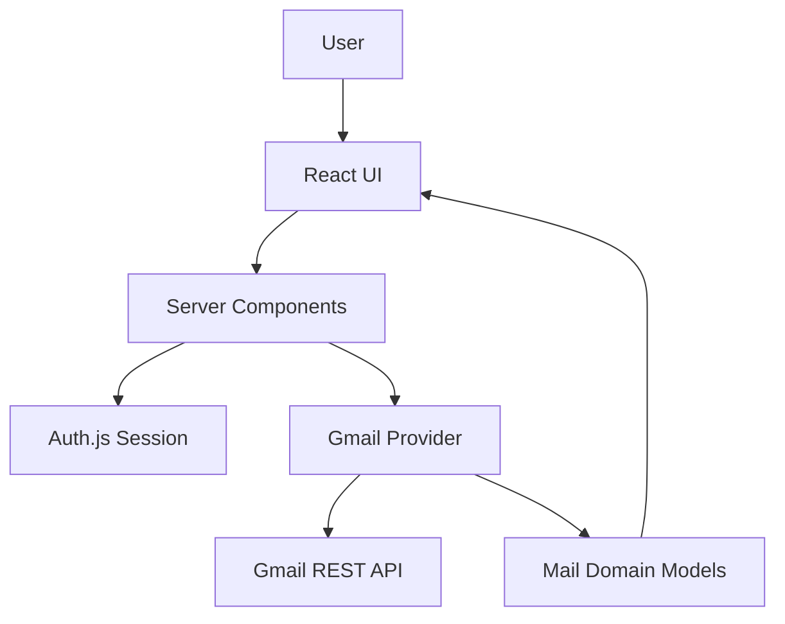

# CommandMail

AI-native email workspace built on Next.js. Gmail is the first provider integration; the product layer consumes application domain models, not provider payloads.

**Current status:** Authentication, inbox browsing, conversation reading, and distraction-free focus mode are implemented. Compose, reply, AI assistant, and client-side caching are not yet built.

## Architecture highlights

- Server Components for authenticated Gmail reads
- Auth.js OAuth with automatic token refresh
- Provider / domain separation (`features/gmail` → `MailThread` / `MailConversation`)
- URL-driven conversation selection (`?thread=`)
- Vertical-slice development
- Shared conversation domain model for future AI features
- Focus Mode reading experience (layout-based, not a modal)

## Current architecture



**Data path:** User → Server Components → Auth.js → Gmail provider → Gmail REST API → `MailThread` / `MailConversation` → React UI.

## Current screens

```
Login
  ↓
Inbox
  ↓
Conversation Viewer
  ↓
Conversation Focus Mode
```

1. **Login** — Google OAuth sign-in
2. **Inbox** — thread summaries in a master-detail workspace
3. **Conversation Viewer** — full thread at `/app?thread=<id>`
4. **Conversation Focus Mode** — distraction-free reading layout

## Design principles

CommandMail follows a few architectural principles throughout the codebase:

- Gmail is an integration, not the product.
- Product UI never depends on provider payloads.
- Vertical slices are preferred over horizontal layers.
- Add abstractions only when repetition appears.
- Every commit should ship a working feature.
- Server Components own authenticated data fetching.
- URL owns shareable application state.
- Ephemeral UI state stays local until justified.

## Project overview

CommandMail is an email workspace where the assistant will eventually be the primary interface. Today, the implemented experience is:

1. Sign in with Google
2. Browse inbox thread summaries
3. Open a conversation from the URL
4. Read messages in the workspace or enter **Conversation Focus Mode** for long-form reading

The codebase follows vertical-slice development: each milestone delivers a working, user-visible increment while keeping provider details isolated from product UI.

## Implemented features

| Area | Status | Notes |
|------|--------|-------|
| Google OAuth (Auth.js / NextAuth v4) | ✅ | JWT session, PKCE, `gmail.readonly` scope |
| Access token refresh | ✅ | Offline access + refresh token in JWT callback |
| Route protection | ✅ | `proxy.ts` guards `/app` and `/login` |
| App shell | ✅ | Sticky header, sidebar, assistant UI shell |
| Inbox thread list | ✅ | Up to 20 threads, normalized `MailThread` model |
| Conversation viewer | ✅ | Full thread via `MailConversation` / `MailMessage` |
| Conversation Focus Mode | ✅ | Layout-based reading mode, keyboard shortcuts |
| Gmail REST integration | ✅ | `fetch()` only — no Google SDK |
| AI assistant | ⬜ | UI shell only |
| Compose / reply | ⬜ | Not started |
| TanStack Query (mail data) | ⬜ | Installed; mail uses Server Components today |
| Zustand | ⬜ | Not used yet |
| Sonner / toast notifications | ⬜ | Not started |

## Current limitations

- Gmail is the only provider.
- Read-only access (`gmail.readonly` scope).
- HTML emails are converted to plain text.
- No offline support.
- No compose or reply.
- No client-side mail caching (TanStack Query not wired for inbox yet).
- No real-time sync.
- Inbox load uses multiple Gmail API requests per page render.

## Tech stack

| Layer | Technology |
|-------|------------|
| Framework | Next.js 16 (App Router), React 19, TypeScript |
| Styling | Tailwind CSS v4, shadcn/ui, Radix UI |
| Auth | Auth.js (`next-auth@4`) with Google OAuth |
| Motion | Framer Motion (login polish) |
| Data fetching (mail) | Server Components + `getServerSession` |
| Installed, not yet used for mail | TanStack Query, Zod, React Hook Form |
| Tooling | ESLint, Prettier |

## Folder structure

```
src/
├── app/
│   ├── (main)/app/          # Authenticated app route (/app)
│   │   └── _components/     # App shell (header, sidebar, assistant)
│   ├── login/               # Login page
│   ├── api/auth/            # NextAuth route handler
│   └── api/health/          # Health check
├── features/
│   ├── auth/                # Auth config, Google provider, token refresh
│   ├── gmail/               # Gmail provider (REST, mappers, internal types)
│   └── mail/                # Product UI, domain types, workspace
├── services/                # Reserved for shared infrastructure integrations
├── shared/                  # UI primitives, constants, lib, hooks
├── config/                  # Site and env config
└── types/                   # NextAuth module augmentation
proxy.ts                     # Route protection middleware
```

## Authentication flow

1. User clicks **Continue with Google** on `/login` (`signIn()` from `next-auth/react`)
2. Google OAuth returns an authorization code (PKCE + `access_type=offline`)
3. Auth.js exchanges the code server-side and stores `access_token`, `refresh_token`, and `expires_at` in the JWT
4. Before expiry, the JWT callback refreshes the access token via Google's token endpoint
5. `session.accessToken` is exposed to Server Components for Gmail API calls
6. Refresh tokens never reach the browser

Unauthenticated requests to `/app` redirect to `/login`. Authenticated users on `/login` redirect to `/app`.

## Gmail integration

- **Provider:** `features/gmail/services/gmail-service.ts`
- **Methods:** `listInbox(accessToken)`, `getConversation(accessToken, conversationId)`
- **Transport:** Gmail REST API via `fetch()` — no Google SDK
- **Normalization:** Gmail responses are mapped to `MailThread` and `MailConversation` before crossing into `features/mail/`
- **MIME:** Plain-text preferred; HTML stripped as fallback for message bodies

The mail UI never imports Gmail response types. The product layer communicates only through `MailThread` and `MailConversation`.

## Conversation viewer

- **URL:** `/app?thread=<conversationId>` selects a conversation
- **Orchestration:** `InboxWorkspace` (server) → `MailAppWorkspace` (client) → `InboxWorkspaceClient`
- **Data flow:** `getServerSession` → `listInbox` + `getConversation` → normalized domain models → presentation components
- **Display:** Sender, recipients, timestamp, subject (once in header), plain-text body (`leading-7`, `max-w-3xl`)

## Conversation Focus Mode

Focus Mode is a **presentation mode** of the same `ConversationView` — not a separate route, modal, or overlay.

| Normal workspace | Focus Mode |
|------------------|------------|
| Sidebar · Inbox · Conversation · Assistant | Conversation only (shell chrome hidden) |

- **Enter:** Expand icon in conversation header, or **`F`** when a conversation is open
- **Exit:** Minimize icon, **`Esc`**, **`F`**, or **Back to inbox** (mobile returns to inbox list)
- **State:** `useState` in `MailAppWorkspace` — not URL, Zustand, or Context
- **Reset:** Switching threads resets focus mode

## Keyboard shortcuts

| Key | Action | When |
|-----|--------|------|
| `F` | Toggle Focus Mode | Conversation loaded, not typing in an input |
| `Esc` | Exit Focus Mode | Focus Mode active |

## Running locally

```bash
cp .env.example .env
npm install
npm run dev
```

Open [http://localhost:3000](http://localhost:3000) — redirects to `/login`.

After signing in, the app is at `/app`. Select a thread or open `/app?thread=<id>` directly.

### Scripts

| Command | Description |
|---------|-------------|
| `npm run dev` | Start development server |
| `npm run build` | Production build |
| `npm run start` | Start production server |
| `npm run lint` | Run ESLint |
| `npm run typecheck` | TypeScript check |
| `npm run format` | Format with Prettier |

### Adding shadcn/ui components

```bash
npx shadcn@latest add dialog
```

Components install to `src/shared/ui/`.

## Environment variables

Copy `.env.example` to `.env` and fill in:

| Variable | Required | Description |
|----------|----------|-------------|
| `NEXTAUTH_SECRET` | Yes | Session encryption secret |
| `NEXTAUTH_URL` | Yes | App URL (e.g. `http://localhost:3000`) |
| `GOOGLE_CLIENT_ID` | Yes | Google OAuth client ID |
| `GOOGLE_CLIENT_SECRET` | Yes | Google OAuth client secret |
| `NEXT_PUBLIC_APP_NAME` | No | Display name |
| `NEXT_PUBLIC_APP_URL` | No | Public app URL |

Google OAuth client must include redirect URI: `http://localhost:3000/api/auth/callback/google`

## Screenshots

<!-- TODO: Add screenshot — Login page -->
<!-- TODO: Add screenshot — Inbox workspace (desktop) -->
<!-- TODO: Add screenshot — Conversation viewer -->
<!-- TODO: Add screenshot — Conversation Focus Mode -->

## Roadmap

### Completed

- [x] Project scaffold and lean folder structure
- [x] Google OAuth end-to-end
- [x] App shell (header, sidebar, assistant UI shell)
- [x] Gmail inbox thread summaries
- [x] Conversation viewer with domain normalization
- [x] Mail workspace UI polish (independent scrolling, typography)
- [x] Google access token refresh
- [x] Inbox fetch resilience and session error UX
- [x] Conversation Focus Mode

### Next

- [ ] Toast notifications (Sonner)
- [ ] Compose email
- [ ] Reply
- [ ] TanStack Query for mail caching
- [ ] AI assistant (summarize, draft, search)
- [ ] Semantic search
- [ ] Real-time sync
- [ ] Zustand for ephemeral UI state (compose draft, assistant streaming)

## Documentation

- [ARCHITECTURE.md](./ARCHITECTURE.md) — system design and current implementation details
- [ENGINEERING_GUIDELINES.md](./ENGINEERING_GUIDELINES.md) — contribution rules and conventions
