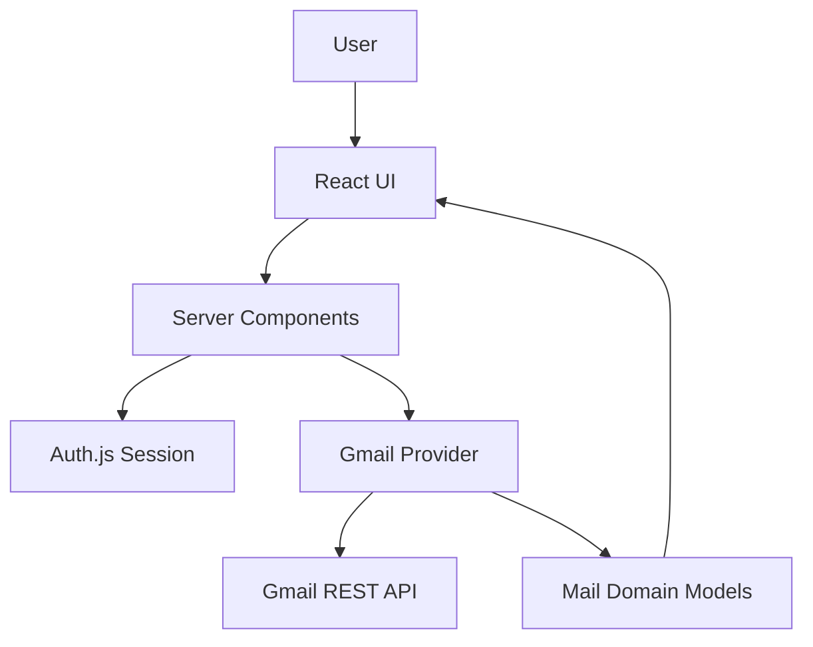

# CommandMail

AI-native email workspace built on Next.js. Gmail is the first provider integration; the product layer consumes application domain models, not provider payloads. An AI assistant sits alongside the mail client and can compose, search, navigate, and reply on the user's behalf — it drives the same UI a person would use, rather than answering in a chat bubble.

**Current status:** Authentication, mailbox navigation (Inbox/Sent/Drafts/Archive/Trash), conversation reading, compose, reply, and a working AI assistant are implemented. Client-side mail caching and real-time sync are not yet built.

## Architecture highlights

- Server Components for authenticated Gmail reads
- Auth.js OAuth with automatic token refresh
- Provider / domain separation (`features/gmail` → `MailThread` / `MailConversation` / `MailDraft` / `ReplyMailDraft`)
- URL-driven conversation selection (`?thread=`)
- Vertical-slice development
- AI assistant that acts through the same domain services as the UI (compose, send, search, reply) instead of a separate code path
- Focus Mode reading experience (layout-based, not a modal)

## Current architecture



**Data path:** User → Server Components → Auth.js → Gmail provider → Gmail REST API → `MailThread` / `MailConversation` → React UI.

## Current screens

```
Login
  ↓
Mailbox (Inbox / Sent / Drafts / Archive / Trash)
  ↓
Conversation Viewer
  ↓
Conversation Focus Mode
```

Plus a floating **AI assistant panel**, available from any screen.

1. **Login** — Google OAuth sign-in
2. **Mailbox** — thread summaries in a master-detail workspace, one view per mailbox
3. **Conversation Viewer** — full thread at `/app?thread=<id>`
4. **Conversation Focus Mode** — distraction-free reading layout
5. **Assistant panel** — compose, search, navigate, and reply through natural language; results appear in the same workspace, not just as chat text

## Design principles

CommandMail follows a few architectural principles throughout the codebase:

- Gmail is an integration, not the product.
- Product UI never depends on provider payloads.
- Vertical slices are preferred over horizontal layers.
- Add abstractions only when repetition appears.
- Every commit should ship a working feature.
- Server Components own authenticated data fetching.
- URL owns shareable application state.
- Ephemeral UI state stays local until justified.

## Project overview

CommandMail is an email workspace where the assistant is a second way to drive the same UI a person would use. Today, the implemented experience is:

1. Sign in with Google
2. Browse Inbox, Sent, Drafts, Archive, or Trash
3. Open a conversation from the URL
4. Read messages in the workspace or enter **Conversation Focus Mode** for long-form reading
5. Compose or reply by hand, or ask the assistant to do it — "send an email to john@... subject ... body ...", "show emails from the last 10 days", "open the latest email from David", "reply to this"

The codebase follows vertical-slice development: each milestone delivers a working, user-visible increment while keeping provider details isolated from product UI.

## Implemented features

| Area | Status | Notes |
|------|--------|-------|
| Google OAuth (Auth.js / NextAuth v4) | ✅ | JWT session, PKCE, `gmail.modify` scope |
| Access token refresh | ✅ | Offline access + refresh token in JWT callback |
| Route protection | ✅ | `proxy.ts` guards `/app` and `/login` |
| App shell | ✅ | Sticky header, sidebar, assistant panel |
| Mailbox navigation | ✅ | Inbox, Sent, Drafts, Archive, Trash — one config-driven list (`MAILBOXES`) |
| Conversation viewer | ✅ | Full thread via `MailConversation` / `MailMessage` |
| Conversation Focus Mode | ✅ | Layout-based reading mode, keyboard shortcuts |
| Compose + send | ✅ | Dialog UI, Server Action → Gmail MIME → `messages.send` |
| Reply | ✅ | Dedicated reply draft with correct threading headers |
| Read/unread tracking | ✅ | Marks a thread read on open |
| Gmail REST integration | ✅ | `fetch()` only — no Google SDK |
| AI assistant | ✅ | Compose, search, open, reply — see below |
| Sonner / toast notifications | ✅ | Send/search/session errors and confirmations |
| TanStack Query (mail data) | ⬜ | Installed; mail still uses Server Components, not client caching |
| Zustand | ⬜ | Not used yet |

## AI assistant

The assistant is a floating panel (`features/assistant`) mounted once at the app layout level, so its conversation and any in-progress draft survive navigating between mailboxes or threads. It talks to Groq (`llama-4-scout-17b-16e-instruct` by default) through `/api/assistant`, and every model response is parsed as JSON and validated with Zod before anything happens — the model can only return one of five actions, never arbitrary instructions:

- `compose_email(to, subject, body)` — opens the compose card and types the fields in visibly
- `send_email()` — sends whatever draft is currently open (only fires on an explicit follow-up like "send it", never automatically)
- `search_emails(query)` — runs a Gmail query; the **inbox list itself swaps to the results**, it isn't just described in chat
- `open_email(threadId)` — opens a specific thread in the detail view, using an ID the model has actually seen (from a prior search or the open conversation), never an invented one
- `reply_email(threadId, body)` — drafts a reply against whichever conversation is currently open

A few things worth knowing about how it's built:

- **Rich drafts, not just text** — compose and reply drafts render as cards in the chat with live status (preparing → writing → draft → sending → sent/failed) and a retry button, not plain paragraphs.
- **Two-step send** — the assistant always shows a draft before sending. Nothing goes out silently.
- **Cost control** — the system prompt is compressed to a short action syntax, context is serialized as compact key/value pairs instead of raw JSON, chat history is trimmed to the last 8 messages, and identical prompt+context pairs are served from an in-memory cache for 5 minutes instead of re-hitting Groq.

What it doesn't do yet: forward a message, ask an explicit "are you sure?" before sending (the draft-first flow is the safeguard today), or filter through dedicated UI controls — filtering only happens when the assistant translates a request into a Gmail query.

## Current limitations

- Gmail is the only provider.
- HTML emails are converted to plain text.
- No offline support.
- No client-side mail caching (TanStack Query not wired for inbox yet).
- No real-time sync — inbox only refreshes on navigation or after send.
- No UI filter controls (date range, sender, keyword, read/unread) — filtering works today only through the assistant.
- Mailbox load uses multiple Gmail API requests per page render (1 list + N thread fetches).
- Assistant can't forward messages, and doesn't ask for explicit confirmation before sending beyond the draft-first flow.

## Tech stack

| Layer | Technology |
|-------|------------|
| Framework | Next.js 16 (App Router), React 19, TypeScript |
| Styling | Tailwind CSS v4, shadcn/ui, Radix UI |
| Auth | Auth.js (`next-auth@4`) with Google OAuth |
| AI | Groq (`llama-4-scout-17b-16e-instruct`), Zod-validated JSON responses |
| Motion | Framer Motion (login polish, assistant draft fill animation) |
| Data fetching (mail) | Server Components + `getServerSession` |
| Installed, not yet used for mail | TanStack Query, React Hook Form |
| Tooling | ESLint, Prettier |

## Folder structure

```
src/
├── app/
│   ├── (main)/app/          # Authenticated app route (/app), mounts AssistantProvider
│   │   └── _components/     # App shell (header, sidebar)
│   ├── login/               # Login page
│   ├── api/auth/            # NextAuth route handler
│   ├── api/assistant/       # Assistant chat endpoint
│   └── api/health/          # Health check
├── features/
│   ├── auth/                # Auth config, Google provider, token refresh
│   ├── gmail/               # Gmail provider (REST, mappers, internal types)
│   ├── mail/                # Product UI, domain types, workspace, compose/reply/search actions
│   └── assistant/           # Assistant panel, action schema, prompt building, executor
├── services/                # Reserved for shared infrastructure integrations (currently empty placeholders)
├── shared/                  # UI primitives, constants, lib, hooks
├── config/                  # Site and env config
└── types/                   # NextAuth module augmentation
proxy.ts                     # Route protection middleware
```

## Authentication flow

1. User clicks **Continue with Google** on `/login` (`signIn()` from `next-auth/react`)
2. Google OAuth returns an authorization code (PKCE + `access_type=offline`)
3. Auth.js exchanges the code server-side and stores `access_token`, `refresh_token`, and `expires_at` in the JWT
4. Before expiry, the JWT callback refreshes the access token via Google's token endpoint
5. `session.accessToken` is exposed to Server Components for Gmail API calls
6. Refresh tokens never reach the browser

Unauthenticated requests to `/app` redirect to `/login`. Authenticated users on `/login` redirect to `/app`.

## Gmail integration

- **Provider:** `features/gmail/services/gmail-service.ts`
- **Methods:** `listThreads(accessToken, mailboxId)`, `searchThreads(accessToken, query)`, `getConversation(accessToken, conversationId)`, `markThreadAsRead(accessToken, threadId)`, `sendMail(accessToken, draft)`, `sendReplyMail(accessToken, draft)`
- **Transport:** Gmail REST API via `fetch()` — no Google SDK
- **Normalization:** Gmail responses are mapped to `MailThread` and `MailConversation` before crossing into `features/mail/`
- **MIME:** Plain-text preferred; HTML stripped as fallback for message bodies

The mail UI never imports Gmail response types. The product layer communicates only through `MailThread` and `MailConversation`.

## Conversation viewer

- **URL:** `/app?thread=<conversationId>` selects a conversation
- **Orchestration:** `InboxWorkspace` (server) → `MailAppWorkspace` (client) → `InboxWorkspaceClient`
- **Data flow:** `getServerSession` → `listThreads` + `getConversation` → normalized domain models → presentation components
- **Display:** Sender, recipients, timestamp, subject (once in header), plain-text body (`leading-7`, `max-w-3xl`)

## Conversation Focus Mode

Focus Mode is a **presentation mode** of the same `ConversationView` — not a separate route, modal, or overlay.

| Normal workspace | Focus Mode |
|------------------|------------|
| Sidebar · Inbox · Conversation · Assistant | Conversation only (shell chrome hidden) |

- **Enter:** Expand icon in conversation header, or **`F`** when a conversation is open
- **Exit:** Minimize icon, **`Esc`**, **`F`**, or **Back to inbox** (mobile returns to inbox list)
- **State:** `useState` in `MailAppWorkspace` — not URL, Zustand, or Context
- **Reset:** Switching threads resets focus mode

## Keyboard shortcuts

| Key | Action | When |
|-----|--------|------|
| `F` | Toggle Focus Mode | Conversation loaded, not typing in an input |
| `Esc` | Exit Focus Mode | Focus Mode active |

## Running locally

```bash
cp .env.example .env
npm install
npm run dev
```

Open [http://localhost:3000](http://localhost:3000) — redirects to `/login`.

After signing in, the app is at `/app`. Select a thread or open `/app?thread=<id>` directly.

### Scripts

| Command | Description |
|---------|-------------|
| `npm run dev` | Start development server |
| `npm run build` | Production build |
| `npm run start` | Start production server |
| `npm run lint` | Run ESLint |
| `npm run typecheck` | TypeScript check |
| `npm run format` | Format with Prettier |

### Adding shadcn/ui components

```bash
npx shadcn@latest add dialog
```

Components install to `src/shared/ui/`.

## Environment variables

Copy `.env.example` to `.env` and fill in:

| Variable | Required | Description |
|----------|----------|-------------|
| `NEXTAUTH_SECRET` | Yes | Session encryption secret |
| `NEXTAUTH_URL` | Yes | App URL (e.g. `http://localhost:3000`) |
| `GOOGLE_CLIENT_ID` | Yes | Google OAuth client ID |
| `GOOGLE_CLIENT_SECRET` | Yes | Google OAuth client secret |
| `GROQ_API_KEY` | Yes (for the assistant) | Groq API key used by `/api/assistant` |
| `ASSISTANT_MODEL` | No | Overrides the default Groq model (`meta-llama/llama-4-scout-17b-16e-instruct`) |
| `NEXT_PUBLIC_APP_NAME` | No | Display name |
| `NEXT_PUBLIC_APP_URL` | No | Public app URL |

Google OAuth client must include redirect URI: `http://localhost:3000/api/auth/callback/google`

## Screenshots

<!-- TODO: Add screenshot — Login page -->
<!-- TODO: Add screenshot — Inbox workspace (desktop) -->
<!-- TODO: Add screenshot — Conversation viewer -->
<!-- TODO: Add screenshot — Conversation Focus Mode -->

## Roadmap

### Completed

- [x] Project scaffold and lean folder structure
- [x] Google OAuth end-to-end
- [x] App shell (header, sidebar, assistant panel)
- [x] Mailbox navigation (Inbox, Sent, Drafts, Archive, Trash)
- [x] Conversation viewer with domain normalization
- [x] Mail workspace UI polish (independent scrolling, typography)
- [x] Google access token refresh
- [x] Inbox fetch resilience and session error UX
- [x] Conversation Focus Mode
- [x] Compose email + send
- [x] Reply with correct threading headers
- [x] Toast notifications (Sonner)
- [x] AI assistant — compose/fill, search, open, context-aware reply, all driving the actual UI

### Next

- [ ] Real-time sync
- [ ] UI filter controls (date range, sender, keyword, read/unread)
- [ ] Forward via assistant
- [ ] Explicit send confirmation step in the assistant
- [ ] TanStack Query for mail caching
- [ ] Zustand for ephemeral UI state
- [ ] Tests
- [ ] Deployed demo

## Documentation

- [ARCHITECTURE.md](./ARCHITECTURE.md) — system design and current implementation details
- [ENGINEERING_GUIDELINES.md](./ENGINEERING_GUIDELINES.md) — contribution rules and conventions
