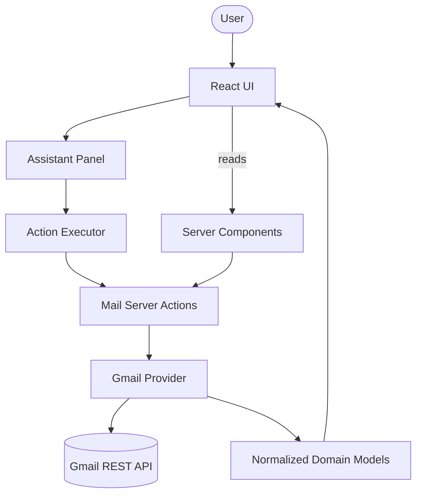

# CommandMail

An email client where an AI assistant **drives the UI** — it doesn't just answer questions in a chat box, it opens the compose form and types into it, swaps the inbox list out for search results, and jumps to a specific thread, all from plain language. Built for the Processity.ai hiring task: _"build a mail app where the AI controls the UI."_

Gmail is the real mail provider — OAuth, real sends, real threads, real-time push. Nothing is mocked. The assistant returns typed, schema-validated actions that run through the **same Server Actions the manual UI uses**, so it can never reach Gmail or the DOM by a side path the buttons don't.

## Demo

<<<<<<< HEAD
<p align="center">
  
</p>

=======
>>>>>>> 992a080 ((Fix): Updated AI Modal as prevous one was decommissioned by GROQ.)
**Video walkthrough:** https://drive.google.com/file/d/1ECoE5GQhcLqfMRSrh8F1VlYsIUuNiPNA/view?usp=sharing

**Live demo:** https://processity-mail-ai-q3n7.onrender.com/login

<<<<<<< HEAD
> **Note**

>

> Since the application uses Google's OAuth verification flow, first-time sign-in may display Google's standard "This app isn't verified" warning because the app is in testing mode. Click **Advanced → Continue** to proceed. This is expected for the assignment deployment.

=======
>>>>>>> 992a080 ((Fix): Updated AI Modal as prevous one was decommissioned by GROQ.)
## Why this exists

The brief asks for a mail app whose AI _controls the interface_ rather than replying about it. The obvious-but-wrong way to build that is to give the model its own path to the mailbox and the DOM — a second, privileged actor sitting next to the user. That is powerful and unsafe: the assistant could do things the UI can't, and you can no longer reason about what any given message might trigger.

CommandMail takes the opposite stance. **The assistant is a second caller of the exact code a click already runs.** The model's only output is a `thought` (the text you see) plus zero or more typed actions drawn from a fixed list. A small executor validates each action and dispatches it through the same Server Actions and handlers the buttons use. The assistant can do everything the UI can do and nothing more — which is precisely the property you want when an LLM is holding the controls.

That one decision shapes the rest of the codebase: Gmail stays behind a normalized domain layer, writes go through Server Actions, and the action schema is the contract between the model and the app.

## How it satisfies the assignment

Every core requirement is implemented against real Gmail — no stubs.

| Assignment Requirement                                    | Status  | Where Implemented                                                                                                                                                |
| --------------------------------------------------------- | ------- | ---------------------------------------------------------------------------------------------------------------------------------------------------------------- |
| Send **and** receive real email                           | ✅ Done | Gmail REST in [`gmail-service.ts`](src/features/gmail/services/gmail-service.ts); send actions in [`features/mail/actions/`](src/features/mail/actions)          |
| Inbox + Sent show real data                               | ✅ Done | Server Component → `listThreads()` → normalized `MailThread[]` ([`inbox-workspace.tsx`](src/features/mail/components/inbox-workspace.tsx))                       |
| Compose + send from the UI                                | ✅ Done | [`compose-email-dialog.tsx`](src/features/mail/components/compose-email-dialog.tsx) + [`sendEmail`](src/features/mail/actions/send-email.ts) Server Action       |
| Assistant fills the compose form from natural language    | ✅ Done | `compose_email` action → visible typing animation into the draft card ([`assistant-provider.tsx`](src/features/assistant/components/assistant-provider.tsx))     |
| Assistant search/filter updates the UI (not a chat reply) | ✅ Done | `search_emails` action → results replace the inbox list ([`execute-assistant-action.ts`](src/features/assistant/executor/execute-assistant-action.ts))           |
| Assistant is context-aware                                | ✅ Done | [`build-assistant-context.ts`](src/features/assistant/lib/build-assistant-context.ts) serializes the current mailbox, open thread, and active draft              |
| Real-time inbox sync                                      | ✅ Done | `users.watch` → Pub/Sub → [`/api/gmail/push`](src/app/api/gmail/push/route.ts) → in-process hub → [`/api/gmail/stream`](src/app/api/gmail/stream/route.ts) (SSE) |

### Bonus requirements

| Bonus Requirement                       | Status  | Where Implemented                                                                                                                                                                        |
| --------------------------------------- | ------- | ---------------------------------------------------------------------------------------------------------------------------------------------------------------------------------------- |
| Reply **and** forward via the assistant | ✅ Done | `reply_email`, `forward_email` actions → [`build-reply-draft.ts`](src/features/mail/lib/build-reply-draft.ts) / [`build-forward-draft.ts`](src/features/mail/lib/build-forward-draft.ts) |
| Human-in-the-loop send                  | ✅ Done | Assistant always shows a draft first; `send_email` fires only on explicit confirmation ([`assistant-provider.tsx`](src/features/assistant/components/assistant-provider.tsx))            |
| Rich rendering in the assistant panel   | ✅ Done | Email cards / lists / filter cards under [`features/assistant/components/rich/`](src/features/assistant/components/rich)                                                                 |
| Thread / conversation view              | ✅ Done | [`conversation-view.tsx`](src/features/mail/components/conversation-view.tsx) + [`normalize-conversation.ts`](src/features/gmail/mappers/normalize-conversation.ts)                      |
| Dark mode                               | ✅ Done | `next-themes` + Tailwind ([`providers.tsx`](src/app/providers.tsx))                                                                                                                      |
| Automated tests                         | ✅ Done | 11 Jest suites under [`tests/`](tests) (pure mail/assistant logic + token crypto)                                                                                                        |
| Deployed                                | ✅ Done | Render, from the [`Dockerfile`](Dockerfile); local production via [`docker-compose.yml`](docker-compose.yml)                                                                             |

## Features

- **Mailboxes** — Inbox, Sent, Drafts, Archive, Trash, all backed by real Gmail data.
- **Conversation / thread view** — full thread reading plus a distraction-free Focus Mode (`F` to toggle, `Esc` to exit).
- **Compose & reply** — real Gmail sends; replies thread correctly via `In-Reply-To` / `References`.
- **Real-time inbox sync** — new mail appears with no refresh, via Gmail Pub/Sub push → server-sent events.
- **Read/unread tracking**, toast feedback, and native notifications when the tab is hidden.
- **AI assistant** that composes, searches, opens, replies, forwards, and navigates — described below.

## The AI assistant

Things you can say to it:

- _"Send an email to john@example.com, subject Meeting Tomorrow, body Let's meet at 3pm"_ — opens the compose card and types the fields in, visibly, not instantly.
- _"Show me emails from the last 10 days"_ — the inbox list itself swaps to the results; it isn't a chat-only answer.
- _"Open the latest email from David"_ — jumps to that thread in the detail view.
- _"Reply to this"_ / _"Forward this to sarah@example.com"_ (while reading a thread) — drafts against that specific conversation.
- _"Go to Sent"_ — navigates between mailboxes.

It runs on **Groq**, and every response is Zod-validated against a fixed action schema before anything happens. The model returns a `thought` (user-facing text) plus zero or more typed actions, and cannot do anything outside this list:

| Action             | Payload              | Effect                                             |
| ------------------ | -------------------- | -------------------------------------------------- |
| `compose_email`    | `to, subject, body`  | Opens and fills the compose draft card             |
| `send_email`       | —                    | Sends whichever draft is currently active          |
| `search_emails`    | `query`              | Runs a Gmail query; results replace the inbox list |
| `open_email`       | `threadId`           | Opens a specific thread in the detail view         |
| `reply_email`      | `threadId, body`     | Drafts a reply against the given conversation      |
| `forward_email`    | `threadId, to, body` | Drafts a forward of the given conversation         |
| `navigate_mailbox` | `mailbox`            | Switches the active mailbox                        |

Drafts render as cards with live status (preparing → writing → sending → sent/failed), not plain text, and nothing sends without an explicit follow-up like "send it" or a button click. See [ARCHITECTURE.md](./ARCHITECTURE.md) for the full pipeline, prompt compression, and context serialization.

## Real-time sync

New mail lands in the inbox with no manual refresh:

1. On sign-in, the app registers a Gmail `users.watch` on the user's `INBOX`, pointed at a Pub/Sub topic ([`gmail-watch.ts`](src/features/gmail/server/gmail-watch.ts)).
2. Gmail publishes change notifications to Pub/Sub, which pushes them to `POST /api/gmail/push`. That endpoint **verifies the OIDC token** from the Pub/Sub service account before trusting the payload.
3. The handler diffs the Gmail history, then publishes an `inbox-changed` event to an in-process hub ([`inbox-hub.ts`](src/server/realtime/inbox-hub.ts)).
4. Each open tab holds a **server-sent events** connection to `GET /api/gmail/stream`; the hub fans the event out, the client calls `router.refresh()`, and shows a toast / native notification.
5. A daily cron (`GET /api/gmail/renew-watch`, protected by `CRON_SECRET`) renews watches before Gmail's 7-day expiry.

> **Scope note:** the realtime hub is in-process, so it assumes a **single app instance**. Horizontal scaling would move the hub to Redis pub/sub (see [Future improvements](#future-improvements)).

## Architecture at a glance



The assistant and the manual UI converge on the same Server Actions and the same Gmail provider. Full write-up — with the OAuth, request-lifecycle, and Pub/Sub diagrams — is in [ARCHITECTURE.md](./ARCHITECTURE.md).

## Tech stack

| Layer     | Technology                                                          |
| --------- | ------------------------------------------------------------------- |
| Framework | Next.js 16 (App Router), React 19, TypeScript                       |
| Styling   | Tailwind CSS v4, shadcn/ui, Radix UI                                |
| Auth      | Auth.js (`next-auth@4`), Google OAuth                               |
<<<<<<< HEAD
| AI        | Groq (`llama-4-scout-17b-16e-instruct`), Zod-validated JSON         |
=======
| AI        | Groq (`openai/gpt-oss-120b`), Zod-validated JSON         |
>>>>>>> 992a080 ((Fix): Updated AI Modal as prevous one was decommissioned by GROQ.)
| Mail      | Gmail REST API via `fetch()` — no SDK                               |
| Data      | Prisma + PostgreSQL (per-user sync state + encrypted refresh token) |
| Realtime  | Gmail `users.watch` → Google Pub/Sub → SSE                          |

## Getting started

### Prerequisites

- Node.js 20+
- A PostgreSQL database (`DATABASE_URL`)
- A Google Cloud project with the **Gmail API** enabled and an **OAuth 2.0 Web client**
- A [Groq API key](https://console.groq.com/)
- _(Optional, for real-time push)_ a Pub/Sub topic + push subscription — the app runs fine without it; the inbox just won't live-update.

### 1. Install and configure

```bash
git clone <repo-url>
cd processity-mail-ai
cp .env.example .env
npm install        # runs `prisma generate` via postinstall
```

Fill in `.env`:

| Variable                                      | Required               | Notes                                                                                       |
| --------------------------------------------- | ---------------------- | ------------------------------------------------------------------------------------------- |
| `NEXTAUTH_SECRET`                             | Yes                    | Session encryption secret (`openssl rand -base64 32`)                                       |
| `NEXTAUTH_URL`                                | Yes                    | e.g. `http://localhost:3000`                                                                |
| `GOOGLE_CLIENT_ID` / `GOOGLE_CLIENT_SECRET`   | Yes                    | OAuth client — redirect URI must be `http://localhost:3000/api/auth/callback/google`        |
| `DATABASE_URL`                                | Yes                    | PostgreSQL connection string                                                                |
| `TOKEN_ENCRYPTION_KEY`                        | Yes                    | base64-encoded 32-byte key for encrypting stored refresh tokens (`openssl rand -base64 32`) |
| `GROQ_API_KEY`                                | Yes, for the assistant | Used by `/api/assistant`                                                                    |
| `ASSISTANT_MODEL`                             | No                     | Overrides the default model                                                                 |
| `GOOGLE_CLOUD_PROJECT` / `GMAIL_PUBSUB_TOPIC` | For realtime           | Project id + Pub/Sub topic for `users.watch`                                                |
| `GMAIL_PUSH_AUDIENCE` / `GMAIL_PUSH_SA_EMAIL` | For realtime           | OIDC audience (webhook URL) + service-account email that signs the push token               |
| `CRON_SECRET`                                 | For realtime           | Bearer secret protecting the watch-renewal cron                                             |

On the OAuth consent screen, grant the `https://www.googleapis.com/auth/gmail.modify` scope (add your account as a test user if the app is in testing mode).

### 2. Set up the database

```bash
npm run db:migrate     # apply Prisma migrations (dev)
# or, against an existing/prod DB:
npm run db:deploy
```

### 3. Run

```bash
npm run dev
```

Open [http://localhost:3000](http://localhost:3000) — it redirects to `/login`. Sign in with Google and you land on `/app`.

Other scripts: `npm run build`, `npm run start`, `npm run lint`, `npm run typecheck`, `npm run format`, `npm test`.

### Docker

The [`Dockerfile`](Dockerfile) is a multi-stage build producing a standalone Next.js server; it's what Render deploys. To run the same image locally:

```bash
cp .env.example .env.production   # then fill in production values
docker compose up --build
```

`docker-compose.yml` also defines a one-shot `migrate` service (`docker compose run --rm migrate`) that applies Prisma migrations against the target database.

## Architecture decisions & trade-offs

Fuller write-up with diagrams in [ARCHITECTURE.md](./ARCHITECTURE.md); the decisions that shaped the code:

- **Gmail is an integration, not the product.** The UI only ever sees normalized domain types (`MailThread`, `MailConversation`, `MailDraft`, `ReplyMailDraft`) — never raw Gmail payloads. Swapping providers wouldn't touch the UI. _Trade-off:_ an extra mapping layer, and no provider interface yet (deferred until a second provider actually exists).
- **The assistant is a second caller of the same Server Actions the UI uses** (send, reply, search, mark-read) — never its own side-effect path. The LLM returns data; a small executor runs it through existing code. _Trade-off:_ the assistant can only do what the UI can do — which is exactly the safety property we want.
- **Reads in Server Components, writes in Server Actions.** No client data cache for mail. _Trade-off:_ a simpler auth boundary and less state, at the cost of a `router.refresh()` round-trip instead of optimistic updates.
- **URL owns shareable state** (`?thread=`, mailbox segment); everything else stays local `useState`/context until it needs to survive a reload.
- **Draft-then-send as the human-in-the-loop step**, rather than a separate "are you sure?" dialog — the visible draft _is_ the confirmation, and `send_email` only fires on an explicit follow-up.
- **In-process realtime hub over infrastructure.** SSE + an in-memory map is the smallest thing that delivers live sync for a single instance. _Trade-off:_ doesn't survive horizontal scaling (see below).
- **Refresh tokens are encrypted at rest** (AES-256-GCM) and never reach the browser; the Pub/Sub webhook verifies its OIDC token before trusting a payload.

## Future improvements

Things intentionally deferred rather than missed:

- **Horizontal-scale-safe realtime** — move the in-process hub to Redis pub/sub so the Pub/Sub webhook and a user's SSE connection don't have to land on the same instance.
- **UI filter controls** — date-range / sender / read-unread pickers that reuse the same Gmail-query builder the assistant's `search_emails` already uses, with filter state owned by the URL.
- **Stricter outbound validation** — sanitize compose/subject fields against header injection at the MIME layer, not just format-validate them.
- **Batch the mailbox fetch** — a mailbox load is currently 1 + N Gmail requests (list, then one per thread); batching the metadata fetch would scale it past ~50 threads.
- **Break up `AssistantProvider`** — it has grown into one large client component; splitting orchestration, typing animation, and context wiring would improve testability.
- **Provider abstraction** — introduce the mail/LLM interfaces once a second provider (Outlook, another model) is actually on the table.
- **Streaming assistant responses** and integration tests around the action executor.

## Project structure

```text
src/
├── app/              # Routes, layouts, API handlers (auth, assistant, gmail push/stream), app shell
├── config/           # Env + site config
├── features/
│   ├── auth/         # OAuth config, token refresh, Google provider
│   ├── gmail/        # Gmail REST integration, mappers, watch/sync, token crypto
│   ├── mail/         # Product UI, domain types, workspace, mail Server Actions, live-sync hook
│   └── assistant/    # Assistant panel, prompt building, action schema, executor
├── server/           # Prisma client, realtime hub
├── shared/           # ui / lib / constants
└── proxy.ts          # Route protection (Next.js middleware): /app requires auth, /login redirects if signed in
```

## Testing

```bash
npm test
```

Jest suites cover the pure logic where bugs are cheapest to catch: Gmail query building, reply/forward header construction, mailbox parsing, recipient formatting, HTML-to-text, the token encryption round-trip, and assistant message utilities.

## Docs

- [ARCHITECTURE.md](./ARCHITECTURE.md) — goals, data flow, state ownership, the assistant pipeline, and the realtime design, with diagrams.
